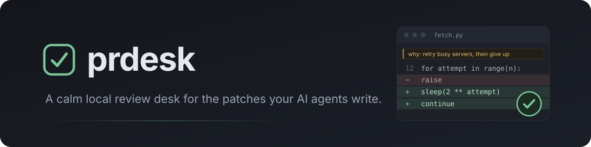
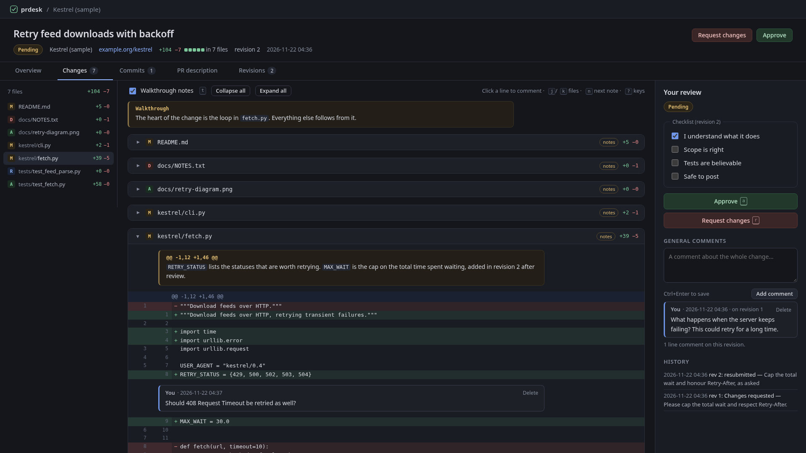
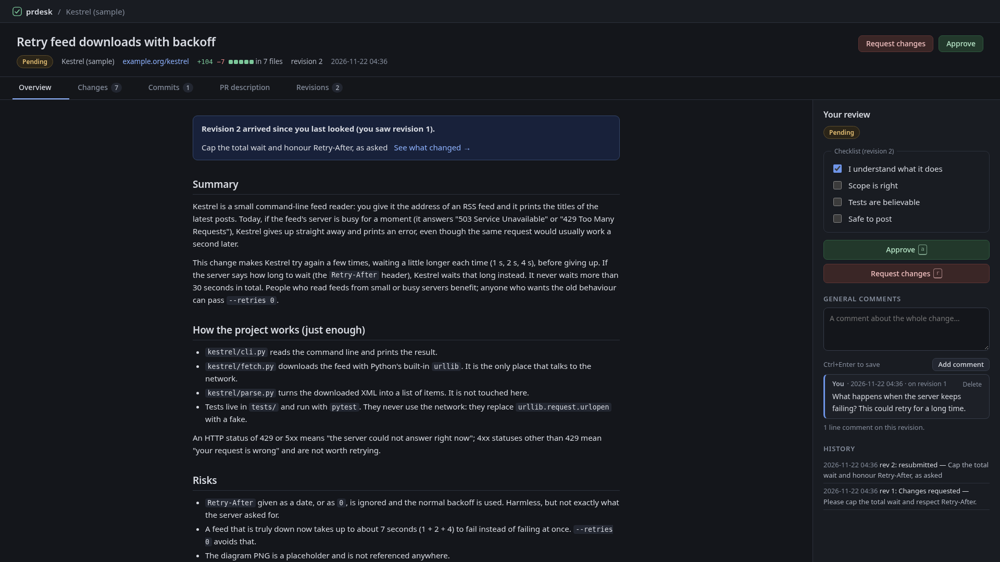

<p align="center"></p>

**Your coding agent wrote a patch for a project you have never opened. prdesk
puts it on your desk with a plain-language walkthrough next to every hunk, and
sends your verdict and line comments back to the agent.** Local, offline, no
dependencies, no git commands to type.

<p align="center"></p>

## Why

Agents are good at producing patches, including for open-source projects you
use but have never read. Before anything goes upstream, a human should
understand it and sign off. Doing that in a terminal means `git status`,
`git diff`, `git log`, scrolling, and guessing at the context the agent had.

prdesk turns that into a reading session:

- The agent submits the branch plus **notes written for a newcomer**: what
  the project is, how the relevant part works, a walkthrough anchored to each
  file and hunk, honest risks, what was and was not tested, and questions for
  you.
- You read the summary, then the diff with the notes **inline next to the
  code**, click any line to comment, tick a short checklist, and press
  **Approve** or **Request changes**.
- The agent reads your decision with `prdesk status --json`, fixes things and
  resubmits. You see **exactly what changed since the revision you last
  looked at**.

Nothing is pushed or posted anywhere. Everything stays in a folder on your
machine.

## Quick start

Needs [Node.js](https://nodejs.org) 20 or newer and git. No `npm install`.

```sh
git clone https://github.com/ZahakJ/prdesk && cd prdesk
bin/prdesk demo      # creates a sample review with two revisions
bin/prdesk serve     # then open http://127.0.0.1:4477/
```

Put `bin/prdesk` on your PATH (symlink it into `~/.local/bin`, or run
`npm install -g .` in the clone) so agents can call `prdesk` directly.

## The agent loop

```sh
# 1. The agent writes notes.md (format: prdesk guide) and checks them against the diff
prdesk check --notes notes.md --repo . --base origin/main --head HEAD

# 2. Submit for review
prdesk submit --repo . --base origin/main --head HEAD \
  --title "Retry feed downloads with backoff" --project "Kestrel" \
  --upstream https://example.org/kestrel --notes notes.md --id kestrel-retries

# 3. You review in the browser. The agent reads the outcome
prdesk status kestrel-retries --json   # or: prdesk wait kestrel-retries --json

# 4. On "changes_requested", the agent fixes, updates notes, resubmits
prdesk resubmit kestrel-retries --notes notes.md -m "Cap the total wait, honour Retry-After"
```

To teach your agent this loop:

- **Claude Code:** copy [`skills/prdesk`](skills/prdesk/SKILL.md) into
  `~/.claude/skills/` (or your project's `.claude/skills/`).
- **Any agent** (Codex, Cursor, Aider, …): paste the snippet from
  [`AGENTS.md`](AGENTS.md) into the instructions file it reads.
- Point the agent at [`WRITING-NOTES.md`](WRITING-NOTES.md), or have it run
  `prdesk guide`, which prints the same text.

## The review page

| Tab | What you get |
| --- | --- |
| **Overview** | Summary, how the project works, risks, what was tested, questions and upstream rules, rendered from the notes. A banner when a new revision arrived. |
| **Changes** | File list with +/− counts; unified diff with line numbers, collapsible files and the walkthrough notes shown above the file, hunk or line they explain. Click a line to comment. Notes can be hidden. |
| **Commits** | Commit messages, when submitted from a repository or `format-patch` output. |
| **PR description** | The text the agent proposes to post upstream, with a copy button. |
| **Revisions** | Every revision, and a diff between any two of them (code and notes), defaulting to "since you last looked". |

The **Your review** panel (always visible on wide screens, a drawer on
laptops) holds the checklist (*I understand what it does*, *Scope is right*,
*Tests are believable*, *Safe to post*), general comments, history, and the
Approve / Request changes buttons. Everything saves as you go.

Keyboard: <kbd>1</kbd>–<kbd>5</kbd> tabs, <kbd>j</kbd>/<kbd>k</kbd> next and
previous file, <kbd>n</kbd>/<kbd>N</kbd> next and previous note,
<kbd>o</kbd> fold file, <kbd>t</kbd> toggle notes, <kbd>c</kbd> comment on
the whole change, <kbd>a</kbd> approve, <kbd>r</kbd> request changes,
<kbd>?</kbd> help.

<p align="center"></p>

## CLI reference

| Command | What it does |
| --- | --- |
| `prdesk submit --repo <path> [--base <ref>] [--head <ref>] --notes <file> --title "..." [--project "..."] [--upstream <url>] [--id <slug>] [-m "..."] [--json]` | Create a review from `base...head` (the diff from their merge-base, as a pull request shows it), the commit messages and the notes. `--base` defaults to the merge-base with `origin/HEAD`, `origin/main` or `main`. |
| `prdesk submit --patch <file> --notes <file> --title "..."` | Same, from a patch file (`git diff` or `git format-patch` output). |
| `prdesk resubmit <id> [same options]` | Add a revision. Omitted options come from the previous revision; omitted `--notes` reuses the previous notes. Status returns to pending. |
| `prdesk status <id> [--json]` | Decision, message, checklist and comments. Exit code 0 approved, 10 changes requested, 11 pending. |
| `prdesk wait <id> [--timeout <s>] [--json]` | Block until approved or changes requested (exit 12 on timeout). |
| `prdesk check --notes <file> (--repo … \| --patch …)` | Lint notes against a diff: missing sections, anchors that match nothing, files without notes. Exit 1 on warnings. |
| `prdesk guide` | Print the notes format. |
| `prdesk list [--json]` | All reviews, newest first. |
| `prdesk serve [--port <n>]` | Serve the app on `127.0.0.1` (default port 4477, or `$PRDESK_PORT`). |
| `prdesk demo` | Create a sample review. |

`prdesk help <command>` or `prdesk <command> --help` shows details. Misuse
exits with code 2 and says what to do.

Data lives in `~/.local/share/prdesk` (override with `PRDESK_HOME`):

```text
reviews/<id>/meta.json            title, project, upstream, current revision
reviews/<id>/decision.json        status, comments, checklist, history (written by the web app)
reviews/<id>/revs/<n>/            patch.diff, notes.md, commits.json, commits.patch, info.json
server.json                       URL of the running server, so CLI output can link to it
```

### `prdesk status --json` (schema `prdesk.status/v1`)

The object is stable within `v1`: fields may be added, never renamed or
removed. A breaking change gets a new schema string.

```json
{
  "schema": "prdesk.status/v1",
  "id": "kestrel-retries",
  "title": "Retry feed downloads with backoff",
  "project": "Kestrel",
  "upstream": "https://example.org/kestrel",
  "revision": 2,
  "status": "changes_requested",
  "decidedRevision": 2,
  "decidedAt": "2026-11-03T10:12:44.120Z",
  "message": "Please also retry 408.",
  "seenRevision": 2,
  "checklist": [
    { "key": "understand", "label": "I understand what it does", "checked": true },
    { "key": "scope", "label": "Scope is right", "checked": true },
    { "key": "tests", "label": "Tests are believable", "checked": false },
    { "key": "safe", "label": "Safe to post", "checked": false }
  ],
  "comments": [
    {
      "id": "3f9c2a1b7d10", "kind": "line", "revision": 2, "at": "2026-11-03T10:11:02.004Z",
      "body": "Should 408 Request Timeout be retried as well?",
      "file": "kestrel/fetch.py", "side": "new", "line": 8,
      "lineText": "RETRY_STATUS = {429, 500, 502, 503, 504}", "hunk": "@@ -1,12 +1,46 @@"
    },
    { "id": "8a0e4c55b2f1", "kind": "general", "revision": 1, "at": "2026-11-02T18:40:31.552Z",
      "body": "What happens when the server keeps failing?" }
  ],
  "history": [
    { "status": "changes_requested", "revision": 1, "at": "2026-11-02T18:41:00.000Z", "message": "Cap the total wait." },
    { "status": "resubmitted", "revision": 2, "at": "2026-11-03T09:30:00.000Z", "message": "Cap the total wait" },
    { "status": "changes_requested", "revision": 2, "at": "2026-11-03T10:12:44.120Z", "message": "Please also retry 408." }
  ],
  "url": "http://127.0.0.1:4477/r/kestrel-retries"
}
```

| Field | Meaning |
| --- | --- |
| `status` | `pending`, `approved` or `changes_requested`, for the current `revision`. A resubmit resets it to `pending`. |
| `decidedRevision`, `decidedAt`, `message` | The decision on the current revision; null/empty while pending. |
| `seenRevision` | Highest revision the reviewer has opened, or null. |
| `comments[].kind` | `line` or `general`. Line comments add `file`, `side` (`new` for added or context lines, `old` for removed lines), `line` (number on that side), `lineText` and `hunk`. |
| `comments[].revision` | The revision the comment was made on. Address the ones on the current revision first. |
| `history` | Decisions and resubmissions, oldest first. |

## Notes format, in short

Full guide with a complete example: [`WRITING-NOTES.md`](WRITING-NOTES.md).

```markdown
# Summary
# How the project works (just enough)
# Walkthrough
  ## path/to/file.ext
  ### @@ -48,13 +48,16 @@ class FeedCache:        (or just the function name)
  ### lines 120-140                                  (new-file line numbers)
# Risks
# What was tested
# Questions for the reviewer
# Upstream rules checked
# PR description                                     (optional, shown in its own tab)
```

## Security model

prdesk renders text written by an AI agent and diffs of code from the
internet, in your browser, with buttons that record decisions. It is built to
be safe with hostile content:

- **Localhost only.** The server binds to `127.0.0.1` and refuses requests
  whose `Host` header is not `127.0.0.1:<port>` or `localhost:<port>`, which
  stops DNS-rebinding pages.
- **No cross-site writes.** Every write is a `POST` with a JSON body and a
  random per-run token that only prdesk's own pages carry. Requests with a
  foreign `Origin` or `Sec-Fetch-Site` are refused. Other websites cannot read
  the token, and cannot send JSON with a custom header without a CORS
  preflight that prdesk never answers.
- **Everything is escaped.** Patch lines, file names, commit messages, notes
  and comments are HTML-escaped. The Markdown renderer is a small built-in one
  that never passes raw HTML through and only links `http(s)` and `mailto`
  URLs, with `rel="noopener noreferrer"`. A strict Content Security Policy
  (`script-src 'self'`, no inline scripts) backs this up.
- **Only its own files.** The server serves its bundled CSS and JS and a fixed
  set of files from review folders, with ids validated and paths checked to
  stay inside the reviews directory.
- **Nothing leaves the machine.** No network calls, no telemetry, no CDN.
  Review folders are created with owner-only permissions.

prdesk is a single-user local tool. Anyone who can run programs as you can
read and change its data, as with any file in your home folder.

## FAQ

**Does it push, open PRs or comment upstream?** No. It is a gate: the agent
acts upstream only after you approve, and only if you tell it to.

**Do I need GitHub?** No. Any git repository, or any patch file, works.

**Which agents work with it?** Anything that can run shell commands. There is
a ready-made Claude Code skill; for others, paste the [`AGENTS.md`](AGENTS.md)
snippet.

**What if the agent's notes are thin?** The Overview flags missing sections,
and `prdesk check` (and `submit`) list them along with anchors that match
nothing. Ask for better notes with *Request changes*.

**Several reviews at once?** Yes. The home page lists them with status,
revision and size.

**Windows?** The CLI and server are plain Node.js and should work; CI runs on
Linux and macOS. Reports welcome.

**Why no syntax highlighting?** Diffs use calm, language-neutral colouring so
any language reads the same and nothing needs to be downloaded. It may come
later as an option.

## Contributing

Issues and pull requests are welcome. Keep it dependency-free and small.

```sh
node --test          # all tests, no install step
bin/prdesk demo && bin/prdesk serve
```

Code style: 2-space indent, single quotes, semicolons, CommonJS, no build
step (see `.editorconfig`). Please add a test with every fix, and keep
escaping and the security checks intact. Commit messages use
`area: summary` (for example `notes: anchor by function name`).

## License

[MIT](LICENSE)
